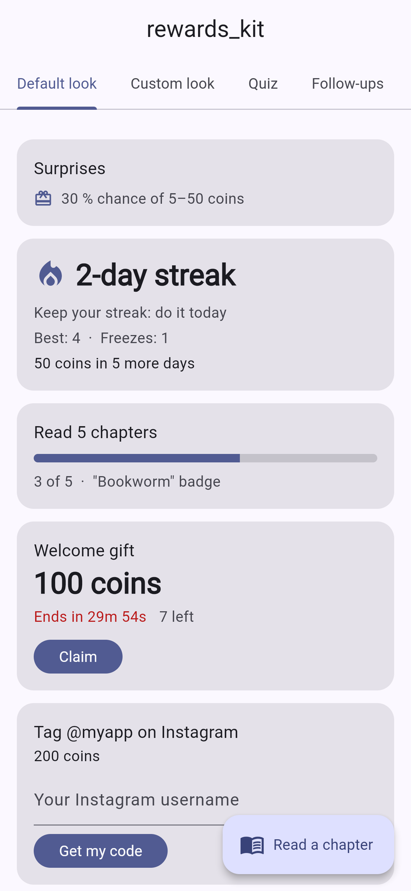
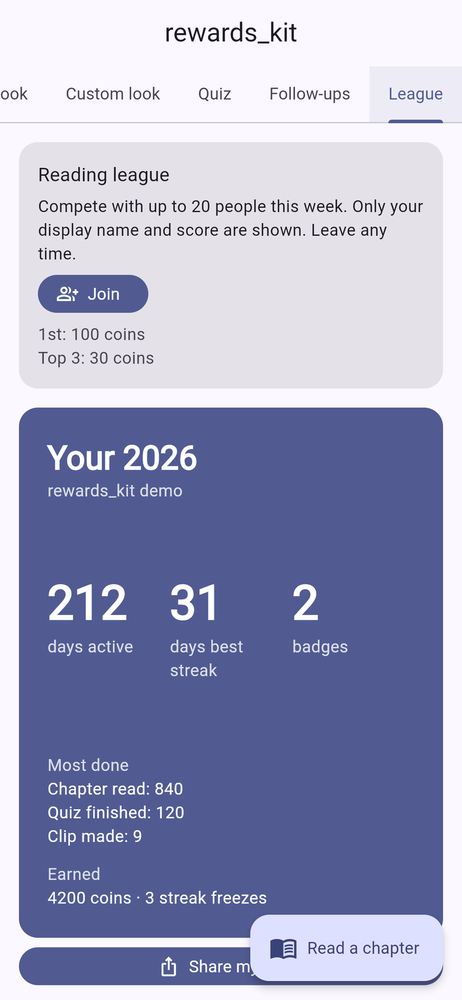
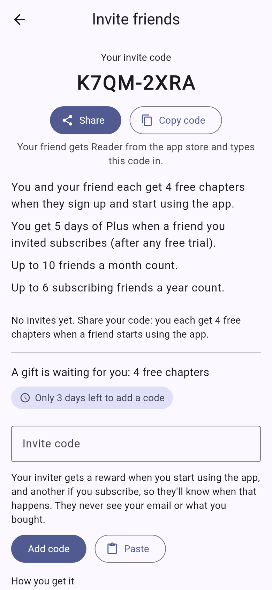
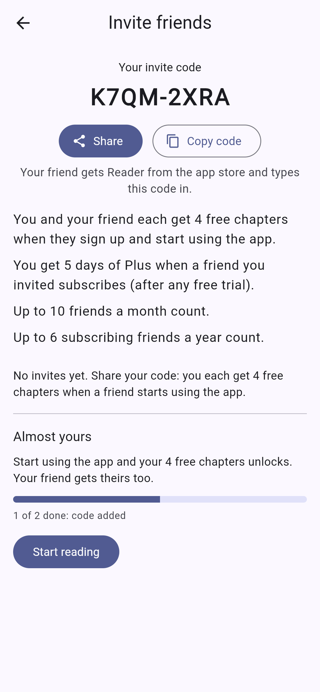
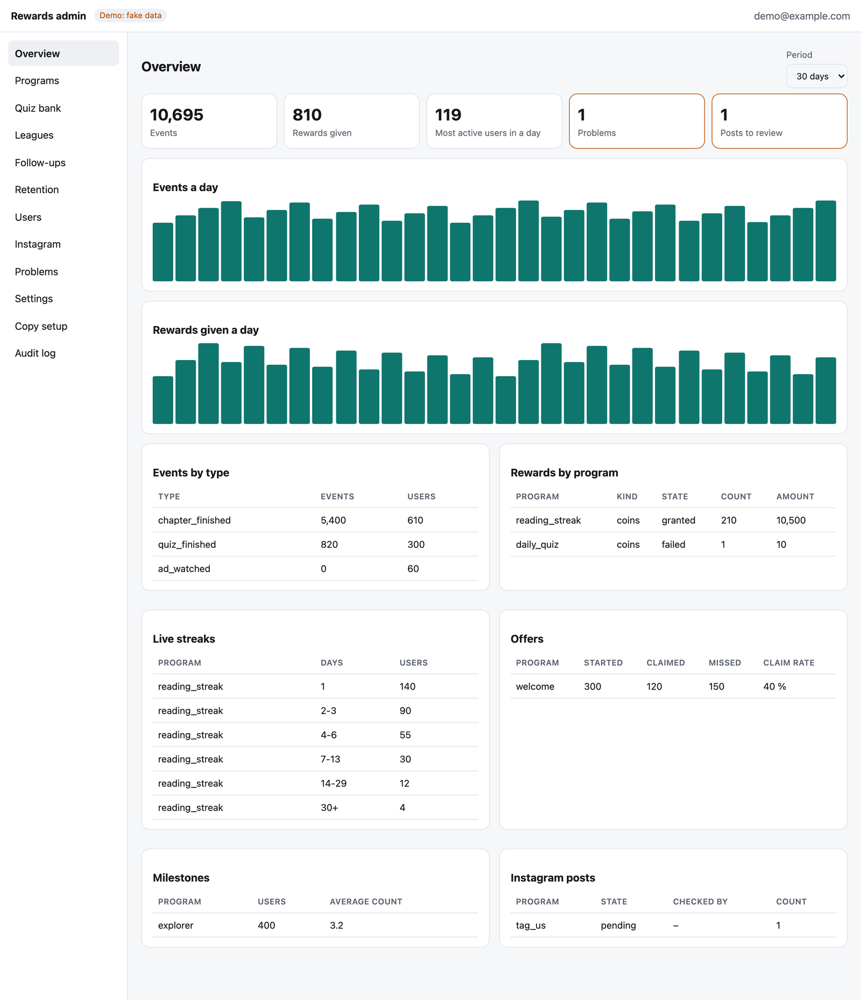

# referral-rewards-kit

  

Built and maintained by [Myind](https://www.myind.ai).

Invite friends, earn rewards: an open-source referral flow for Flutter apps on Supabase with RevenueCat billing.

- A user shares a code; when an invited friend starts using the app, both can get an in-app reward.
- When the friend becomes a paying subscriber, the sharer gets free subscription days, granted through RevenueCat.
- Built to pass App Store and Google Play review, grant every reward exactly once, and keep personal data out.

  
  
  
  

Every screen, with what it shows: [docs/showcase.md](docs/showcase.md).

Status: **built and tested locally; not yet proven on real phones or against a live RevenueCat project.** Design:
[ADR 0001](docs/adr/0001-referral-kit.md). Add it to an app: [integration guide](docs/integration.md) (`flutter pub add referral_kit`, or a git dependency
on tag `referral_kit-v0.5.0`, one SQL file from [the template](supabase/app-config/template.sql), one `InviteHub`,
`onEvent` to your analytics), or start from the [starter app](examples/starter_app). Before release:
[test plan](docs/test-plan.md) and [store review](docs/store-review.md). Go live: [checklist](docs/go-live.md).

| Part | Path | Tests |
|---|---|---|
| Database (schema `referral`, RPCs, grant probe) | `supabase/migrations`, `supabase/tests`, `supabase/probes` | 309 SQL |
| Per-app config | `supabase/app-config/template.sql`, `examples/reader-app/app_config.sql` | in the SQL count |
| Edge Function (`/webhook`, `/worker`) | `supabase/functions/referral` | 128 Deno + full story |
| Flutter package (0.3.0) | `packages/referral_kit` | 268 |
| Starter app (fake server) | `examples/starter_app` | 2 (full flow) |
| Invite page + preview image | `web/invite` | 16 |

**New app? Start here:** [fresh app quick start](docs/fresh-app-quickstart.md) (`scripts/install-into-app.sh` copies the server parts).

**Rewards engine (0.2):** streaks, a daily quiz, milestones, quests, friend streaks, comebacks, recharges, time windows,
Instagram tag rewards, timed offers, surprise rewards with shown odds, RevenueCat-verified rewarded ads and follow-ups
that bring people back (notifications and emails with guardrails), any mix per app (copy a setup between apps
with export/import or a preset), in one exactly-once ledger, with an admin API for setup, checks and analytics, and a Flutter package whose
widgets take the app's own look. Not yet proven on a live project or a phone. Design:
[ADR 0002](docs/adr/0002-rewards-engine.md) · add it: [rewards integration](docs/rewards-integration.md) · API for
the app and a dashboard: [rewards-api.md](docs/rewards-api.md).

| Rewards part | Path | Tests |
|---|---|---|
| Database (schema `rewards`, user + admin API) | `supabase/migrations/*_rewards_*`, `supabase/tests/13..28` (26 is referral) | 537 SQL |
| Per-app config, presets | `supabase/app-config/rewards-template.sql`, `supabase/app-config/presets/*.json` | in the SQL count |
| Edge Function (`/worker`, `/instagram`, `/revenuecat`, `/followups`, `/unsubscribe`) | `supabase/functions/rewards` | 57 Deno + story |
| Flutter package (0.6.0) | `packages/rewards_kit` | 186 |
| Admin page (static, demo mode) | `web/rewards-admin` | 17 Deno |
| Rewarded-ad live check (RevenueCat + AdMob) | `examples/rewards_ads_check` | 3 + APK build |
| Follow-up notifications + device timezone check | `examples/rewards_notifications_check` | 5 + APK build |

Run the database tests: `scripts/test-db.sh` (Postgres 15+ on PATH, or `PGBIN=...`).

Contributing: [CONTRIBUTING.md](CONTRIBUTING.md). Security reports: [SECURITY.md](SECURITY.md). Known problems: [docs/ISSUES.md](docs/ISSUES.md); what is not proven yet: [docs/TODO.md](docs/TODO.md).

Licence: [MIT](LICENSE). Secrets: copy [.env.example](.env.example); real values never go in the repo.
