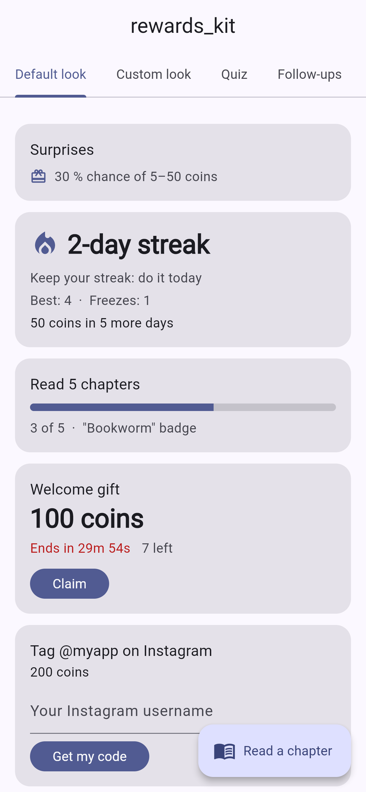
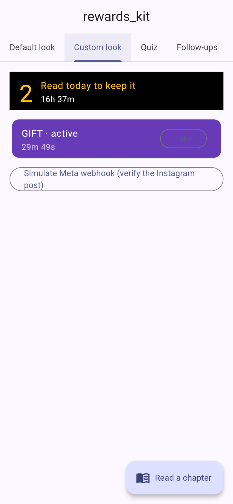
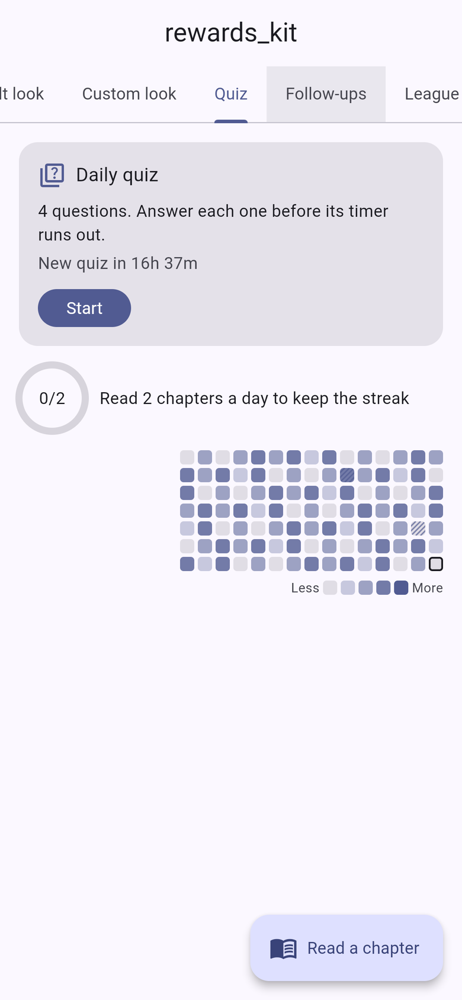
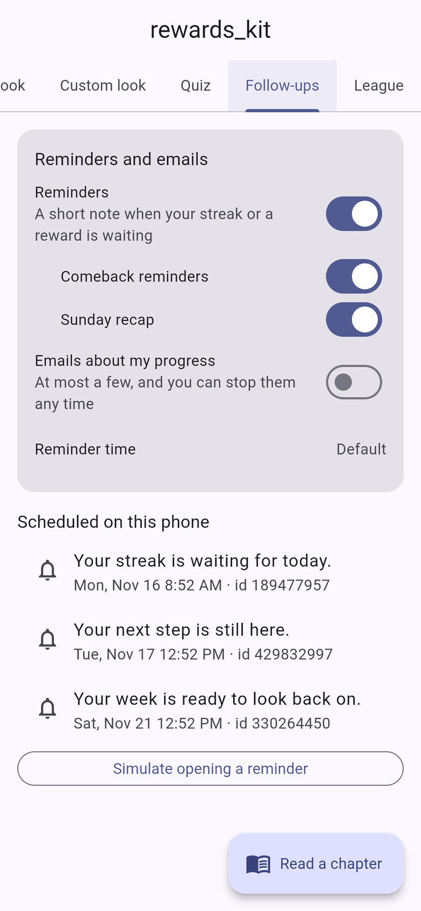
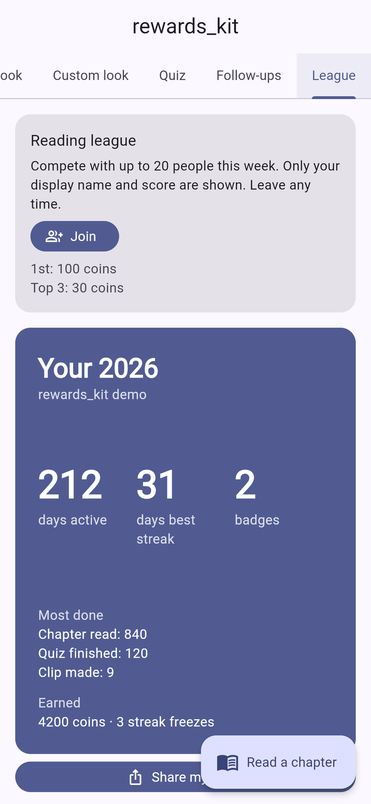
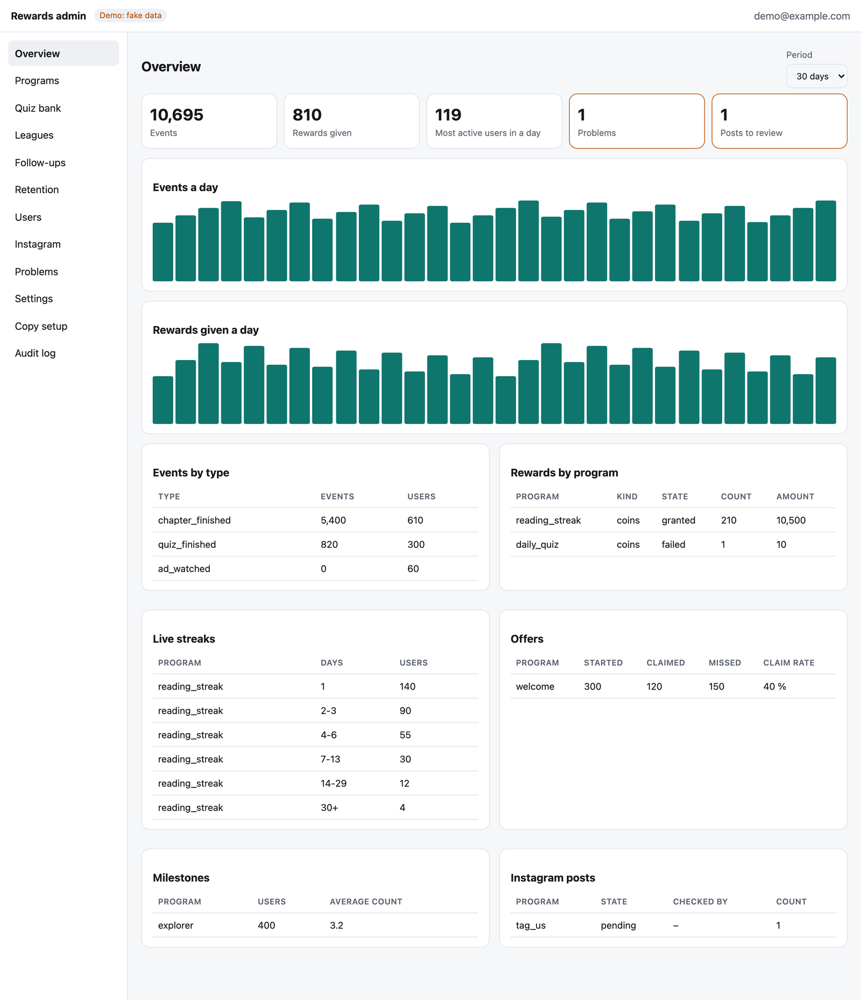

# rewards_kit

Built and maintained by [Myind](https://www.myind.ai).

Flutter side of the rewards engine ([ADR 0002](https://github.com/shaantanu9/referral-rewards-kit/blob/main/docs/adr/0002-rewards-engine.md)): daily streaks, milestones
(quizzes passed, chapters read, friends invited), Instagram tag rewards, timed offers, and since 0.2 a daily quiz,
quests, recharges, time windows, friend streaks, an activity heatmap, recaps and rewarded ads through RevenueCat, and
since 0.3 surprise rewards with a reveal, and since 0.4 follow-ups that bring people back (notifications planned by the
engine, scheduled by the app; since 0.5 with one off switch per kind of reminder), and since 0.6 opt-in weekly leagues
and a shareable year recap card.
One state call, one track call, and widgets whose look is entirely yours.

<p>
  
  
  
  
  
</p>

The admin dashboard that comes with it (`web/rewards-admin`, a static page):



Status: **0.6.3, tested with fakes (`flutter test`); not yet run against a live project or on a phone.** It
matches the server in `supabase/migrations/*_rewards_*` (ADR 0002 §18; SQL tests 13–28); the 0.4 / 0.5 follow-up calls
match the contract in ADR 0002 §18.7 and §18.8.

## Install

```sh
flutter pub add rewards_kit
```

The server side (SQL migrations, Edge Function, admin page) lives in the [repository](https://github.com/shaantanu9/referral-rewards-kit); start with the [rewards integration guide](https://github.com/shaantanu9/referral-rewards-kit/blob/main/docs/rewards-integration.md).

## Quick start

```dart
final rewards = RewardsController(
  client: RewardsClient(
    rpc: (fn, params) => Supabase.instance.client.rpc(fn, params: params),
    // flutter_timezone 5.x returns a TimezoneInfo; its identifier is the IANA name. Streak days are counted in it.
    timezone: () async => (await FlutterTimezone.getLocalTimezone()).identifier,
    onEvent: (e) => analytics.log(e.name.wire, e.props),
  ),
);

// After a quiz, a chapter, a lesson: (or let a database trigger do it, see docs/rewards-integration.md)
await rewards.track('quiz_passed', dedupeKey: 'quiz:$attemptId');

// A whole rewards screen:
RewardToastListener(controller: rewards, child: RewardsHub(controller: rewards, onOpenInstagram: openInstagram));
```

## Your own look

Every widget takes a `builder` that replaces it entirely:

```dart
StreakCard(
  controller: rewards,
  builder: (context, streak, c) => MyFlame(
    days: streak.current,
    leftToday: Countdown(endsAt: streak.endsTodayAt, clock: c.clock),
  ),
);
```

Lighter changes: `RewardsTheme` in `ThemeData.extensions` (colours, radius, text styles), `RewardsTexts` for words
(`RewardsTexts(reward: (r) => '${r.amount} gems', claim: 'Grab it')`), and `RewardsHub.programBuilders` to swap one
program. The example app shows the default and a fully custom look side by side.

## Honest timers

Every deadline (`ends_today_at`, an offer's `ends_at`, a social code's `expires_at`) is a server value that never
resets, and `Countdown` runs on `ServerClock` (corrected from `server_time`), so changing the phone's clock changes
nothing. Stock is shown only when the app turns `show_stock` on, and it is the real count.

## Daily quiz

A `quiz` program serves today's questions from the app's bank; the server keeps every deadline and never sends an
answer before it is given.

```dart
QuizCard(controller: rewards, program: 'quiz'); // Start / Resume / result, time left today; opens QuizScreen

// Or your own route:
QuizScreen(
  controller: rewards,
  program: 'quiz',
  onPlaySound: (id) => player.play(AssetSource('sounds/$id.mp3')), // "listen" questions
  imageBuilder: (context, url) => Image.network(url),                // "picture" questions
);
```

`QuizController` runs the flow without any UI (`open`, `start`, `answer(i)`, `next`, `retry`; `phase`, `question`,
`timeLeft`, `timeFraction`, `lastAnswer`). The countdown uses `ServerClock`; when it reaches zero the controller
sends "no answer" (`choice: -1`). After an app restart `open()` resumes the same question with the same deadline.
Question kinds: `choice`, `true_false` (two buttons; no choices = True / False as 0 / 1), `odd_one_out`, `listen`,
`picture`; an unknown kind is shown as a choice list. The package adds no audio or image plugin.

## Quests, recharges, windows

```dart
QuestList(controller: rewards, program: 'daily_quests');   // tasks, progress, bonus, "Resets in"
RechargeMeter(controller: rewards, program: 'hearts');     // ♥♥♡  Next in 1h 05m
WindowBadge(controller: rewards, program: 'happy_hour');   // "Happy hour: ends in 49m" / "starts in 2h"
await rewards.useRecharge('hearts');                        // null, or 'empty'
```

Name quest tasks with `RewardsTexts(programs: ProgramTexts(questTask: (t) => myNames[t.key]!))`. A refill or window
edge reloads the state from the server; the phone never adds a unit or opens a window itself.

## Friend streaks

```dart
FriendStreaks(
  controller: rewards,
  program: 'buddies',
  onShareInvite: (code) => Share.share('Keep a reading streak with me: $code'), // your share sheet
);
```

Invite makes a code (valid 7 days); the friend types it into "Friend's code". Refusals (`bad_code`, `own_code`,
`too_many_friends`, `already_friends`) show as a line. `friend_name` is shown only to the pair; analytics never
carry codes or ids.

## Activity heatmap, daily goal, recap

```dart
ActivityHeatmap(controller: rewards);        // weeks × 7, today outlined, frozen days striped
DailyGoalRing(controller: rewards);          // "1/2" until the day counts
RecapCard(controller: rewards, from: DateTime(2026, 11, 8), to: DateTime(2026, 11, 14));
```

## Weekly league (opt-in) and the share card (0.6)

```dart
LeagueBoard(controller: rewards, program: 'weekly', maxRows: 10);  // Join → board by display name → Leave

final shareKey = RecapShareKey();
final (from, to) = recapYear(2026);           // rewards.loadRecap(from, to) first
RewardsRecapCard(recap: rewards.recap(from, to)!, subtitle: 'MyApp', shareKey: shareKey);
final png = await shareKey.toPngBytes();      // hand to share_plus: XFile.fromData(png!, mimeType: 'image/png')
```

The league shows other members only by `rewards_app.app_display_name` (or "A member") and score, never an id; it
never marks who moves down. The package shares nothing itself and adds no dependency.

Heatmap levels: 0 none, 1 below the daily goal, 2 goal met, 3 twice, 4 three times or more. `cellBuilder` draws your
own cell. History loads once (`loadHistory`) and a `track` updates today's cell.

## Moments: celebrate at the right time

```dart
RewardToastListener(controller: rewards, holdUntilMoment: true, child: reader);
// … at the end of a chapter:
rewards.celebrateNow(); // shows every reward that arrived while reading
```

The default (`holdUntilMoment: false`) still announces each reward at once.

## Streak reminder

```dart
final at = streakReminderAt(rewards.state.streak('daily')!, now: DateTime.now());
if (at != null) plugin.zonedSchedule(id: 1, scheduledDate: tz.TZDateTime.from(at, tz.local), ...); // your own
```

Null when today is done, there is no streak, or the time has passed. Default: 3 hours before the end of the user's
day; inside quiet hours (22:00–09:00) it moves earlier, to 21:59. Schedule **at most one a day**, only for users who
opted in, and cancel it when the day is done. The engine never sends a push.

## Mystery rewards: always show the odds

A `mystery` reward is picked at grant time from a table. Wherever one is offered, show what it can be and how
likely each outcome is, before it is earned:

```dart
MysteryOdds(reward: streak.nextReward!); // 70%  10 coins · 29.5%  100 coins · 0.5%  1 streak freeze
```

`StreakCard` and `MilestoneProgress` already include it. Mystery rewards are free only and never sold (app store
loot-box rules); hiding the odds is not allowed by this kit.

## Surprise rewards and the reveal

Unexpected rewards keep their pull without wearing down the user's own motivation, as long as they stay honest
(ADR 0002 §18.6). The admin side turns them on per rule, in the rule's `params`:

```json
{"chance": 0.1}
```

When the rule would pay, it pays only with this probability (a miss pays nothing and is not retried, so use it with
`every` rules, quests or quiz tiers). The grant carries `params.surprise = true`.

```json
{"amount_range": [5, 50]}
```

The amount is drawn uniformly between the two whole numbers; the rule's `amount` must be the max (50). The grant
carries `params.range = [5, 50]` and the amount actually won. Both can be combined: `{"chance": 0.1,
"amount_range": [5, 50]}` shows as "1 in 10 chance of 5–50 coins".

```dart
RewardToastListener(controller: rewards, child: app); // surprises open the reveal, one at a time; others a snackbar
SurpriseOdds(controller: rewards);                     // "1 in 10 chance of 5–50 coins" (RewardsHub already has it)
await showRewardReveal(context, grant, onEvent: rewards.client.report); // or open one yourself
RewardReveal(grant: grant, builder: (context, grant, opened, open) => MyGift(opened: opened, onTap: open));
```

A grant is revealed (rather than toasted) when its params have `surprise`, `mystery` or `range`. The reveal is a
closed gift; a tap gives a medium haptic (`HapticFeedback`, no plugin), a short shake and scale-up (about 600 ms) and
the reward pops in. With reduced motion (`MediaQuery.disableAnimations`) it opens at once, no shake.

Guardrails, kept by the kit and the engine:

- **Free only.** Surprises, mystery rewards and ranges are earned by doing things, never sold.
- **Odds shown.** `SurpriseOdds` (and `MysteryOdds` for mystery tables) states the chance and the range before
  anything is earned; `RewardsHub` shows it under the inbox. Do not hide it.
- **No near miss.** The reveal shows only what was won. There is no "almost", "so close" or "you could have won 50"
  text, and none should be added through `RevealTexts` or a builder.
- **Daily cap.** The engine pays at most `settings.surprise_daily_cap` surprises per user in 24 h (default 3, 0 turns
  surprises off); over the cap the draw is skipped. The cap is not in the state, so the app cannot (and need not)
  show it.

`RewardToastListener(revealSurprises: false)` keeps the 0.2 snackbar for every grant; `onGrant` still replaces all.

## Follow-ups (bring people back)

The engine knows each user's activity, streak deadlines and waiting rewards, so it plans the nudges (ADR 0002
§18.7): an app turns on `followup` programs ("inactive 2 days", "streak at risk", "reward waiting", "weekly recap"),
and the phone schedules what `rewards_followups_plan` returns, 14 days ahead. The package has no notification
plugin: the app implements `FollowupNotifier` with its own.

```dart
// In the app (not this package). Compiled in examples/rewards_notifications_check/lib/local_followup_notifier.dart
// against flutter_local_notifications 22.3.3 and timezone 0.11.2 (named parameters since 20; check your version).
import 'package:flutter_local_notifications/flutter_local_notifications.dart';
import 'package:rewards_kit/rewards_kit.dart';
import 'package:timezone/timezone.dart' as tz;

class LocalFollowupNotifier implements FollowupNotifier {
  LocalFollowupNotifier(this.plugin);
  final FlutterLocalNotificationsPlugin plugin;

  @override
  Future<void> cancel(List<int> ids) async {
    for (final id in ids) {
      await plugin.cancel(id: id);
    }
  }

  @override
  Future<void> schedule({
    required int id,
    required DateTime at,
    required String title,
    required String body,
    required String payload,
  }) => plugin.zonedSchedule(
    id: id,
    scheduledDate: tz.TZDateTime.from(at, tz.local),
    notificationDetails: const NotificationDetails(
      android: AndroidNotificationDetails('followups', 'Reminders'),
      iOS: DarwinNotificationDetails(),
    ),
    androidScheduleMode: AndroidScheduleMode.inexactAllowWhileIdle,
    title: title,
    body: body,
    payload: payload,
  );
}

final scheduler = FollowupScheduler(
  controller: rewards,
  notifier: LocalFollowupNotifier(plugin),
  store: PrefsFollowupIdStore(), // your FollowupIdStore on shared_preferences; the default forgets on restart
);
scheduler.start();          // after sign-in: plans now and after every refresh / track (2 s debounce)
await scheduler.stop();     // on sign-out: cancels every notification it scheduled

// When a notification is tapped (its payload is the route to open):
await rewards.followupOpened(program); // tracks followup_opened once per program and local day, then reloads
```

**Call `stop()` on sign-out**, or the next person on the phone gets the last one's reminders. Each replan cancels
what is no longer planned and schedules (again, by the same id) every item still in the future; past items are
never scheduled. Times are moved onto the phone's clock when it is off from the server's. Errors never throw: they
are reported as `rewards_followups_failed` with a reason, and the next change tries again.

The user's choices: the "Reminders" switch, under it one switch per kind of reminder (0.5: each `group` of the
app's live notification follow-ups, labelled with the program's `group_label`; off while reminders are off), the
emails switch and the reminder time:

```dart
FollowupSettings(controller: rewards, onChanged: (_) => scheduler.replanNow());
FollowupSettings(controller: rewards, showEmails: false); // an app that sends no follow-up emails
await rewards.client.followupPrefs({'notifications_off': true}); // or save them yourself
await rewards.client.setFollowupGroupMuted('recap', true);       // mute one kind (sends the new muted_groups)
```

A muted group is not planned by the engine, so replanning (`onChanged`) removes its notifications from the phone.
With your own `builder`, make the per-kind switches from `prefs.groups` and save with
`save(prefs.groupMutedPatch(group, muted))`.

Also in 0.5, all configured on the server, nothing to do in Flutter (ADR 0002 §18.8): a plain daily reminder
trigger, `activity_events` (which events count as activity), `min_actions`, the `app_excluded_from_followups` hook
(staff and testers) and branded email templates.

Guardrails, kept by the engine for every app (the app cannot loosen them):

- **Notifications:** at most one per local day per group; none inside quiet hours (21:00–08:00 by default; a nudge
  moves to one minute before they start); none for users who turned reminders off; the text never names content
  (keep a program's `body` generic); replanned on every activity, so "inactive 2 days" disappears the moment the
  user acts.
- **Emails:** off until `settings.email_followups_enabled`; never to admins or users who turned emails off; each
  email program at most once per user, at most 3 follow-up emails per user ever and none within 4 days of the
  last; every email has a one-click unsubscribe.
- **Ask first.** Schedule only for users who allowed notifications (the OS permission is the app's to ask, after the
  first moment of value), and keep `FollowupSettings` reachable from the app's settings.

## Rewarded ads through RevenueCat

The app shows the ad with RevenueCat's AdMob adapter; RevenueCat verifies it and tells the engine through its
webhook (ADR 0002 §18.5). This package depends on neither RevenueCat nor AdMob.

The tested way: copy `examples/rewards_ads_check/lib/revenuecat_rewarded_ad.dart` into the app (compiled against
`purchases_flutter` 11.0.2, `purchases_admob_flutter` 11.0.2, `google_mobile_ads` 8.0.0; an Android debug build of
the check app passes) and pass its `show` to the button:

```dart
// pubspec: purchases_flutter: ^11.0.2, purchases_admob_flutter: ^11.0.2, google_mobile_ads: ^8.0.0
await Purchases.configure(PurchasesConfiguration(revenueCatPublicKey));
await Purchases.logIn(supabaseUserId); // the engine ignores ads it cannot tie to a Supabase user
await MobileAds.instance.initialize();

RewardedAdButton(
  controller: rewards,
  label: 'Watch an ad for 10 gems',
  enabled: adsEnabled, // your own switch; the engine counts only while settings.ads_enabled is on
  onShowAd: RevenueCatRewardedAd(adUnitId: rewardedUnitId, placement: 'bonus').show,
);
```

Inside, it is RevenueCat's own API: `RevenueCatAdMob.loadAndTrackRewardedAd(adUnitId:, request:, placement:,
rewardedAdLoadCallback:)`, then `ad.enableRewardVerification()`, then `ad.showWithRewardVerification(
onRewardVerificationCompleted: (result) {…})`, where `result.failed`, `result.reward` and `result.moreRewards` hold
`VerifiedVirtualCurrencyReward(code, amount)`, `VerifiedEntitlementReward(identifier, expiresAt)`,
`VerifiedNoReward` or `VerifiedUnsupportedReward`.

Two separate rewards, do not mix them up:

- **The ad's own reward** (in-app currency and/or a temporary entitlement) is set per ad unit in **RevenueCat's
  dashboard** and granted by RevenueCat.
- **The engine counts the ad** as an `ad_watched` event, so streaks, milestones and quests can listen ("watch 5 ads →
  badge"). After a verified ad the button reloads the state at once and again after 5 s and 20 s (the webhook
  arrives a little later).

Google's sample ad unit ids load and show but are never verified (no server-side verification): use a real unit.

## Analytics events

| Event | Props |
|---|---|
| `rewards_state_loaded` | `programs`, `inbox` |
| `rewards_tracked` | `type`, `duplicate`, `grants` |
| `rewards_grant_received` | `program`, `kind`, `amount`, `state` |
| `rewards_offer_claimed` | `program`, `result` |
| `rewards_social_started` | `program`, `result` |
| `rewards_social_code_copied`, `rewards_instagram_opened` | `program` |
| `rewards_inbox_seen` | `count` |
| `rewards_quiz_started` | `program`, `result` |
| `rewards_quiz_answered` | `program`, `index`, `correct`, `timed_out` |
| `rewards_quiz_finished` | `program`, `score`, `total`, `grants` |
| `rewards_recharge_used` | `program`, `units`, `result` |
| `rewards_friend_invited` | `program`, `result` |
| `rewards_friend_accepted`, `rewards_friend_removed` | `result` |
| `rewards_social_link_submitted` | `program`, `result` |
| `rewards_ad_reward_shown` | `result` (`verified`, `not_verified`, `error`) |
| `rewards_reveal_opened` | `program`, `kind` |
| `rewards_followup_opened` | `program` |
| `rewards_followups_planned` | `count` |
| `rewards_followup_prefs_changed` | `field` (never the value) |
| `rewards_followups_failed` | `reason` |
| `rewards_unavailable` | `reason` |

No event carries a user id, an Instagram handle, a code, a post link, or a friend's id or name.
